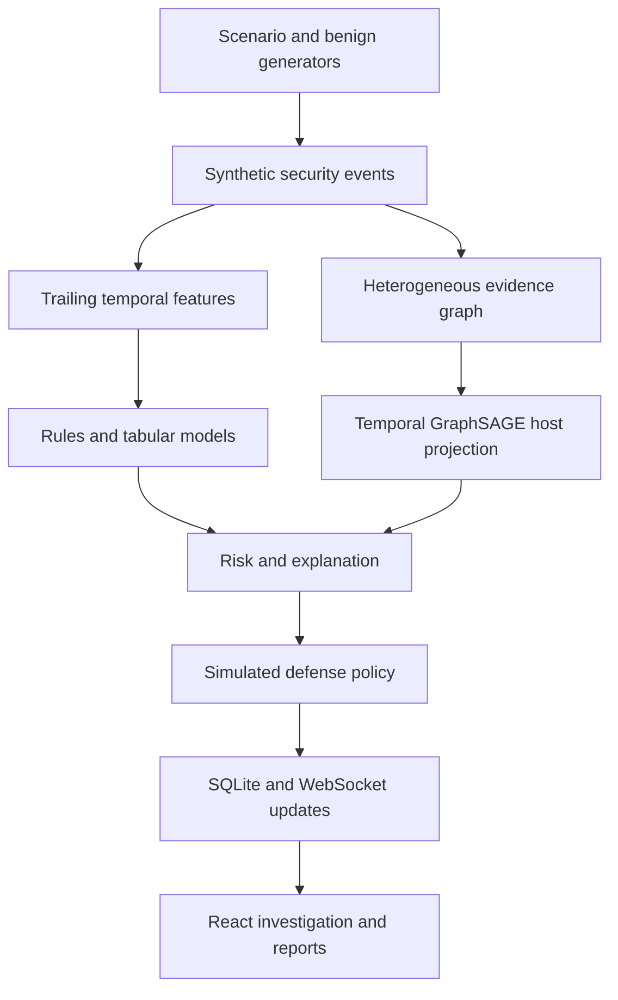

# Sentinel Graph

**Explainable Temporal Graph Neural Network for Early Detection of Lateral Movement in Enterprise Networks**

A single-laptop MCA project for Rajan Singh. It generates synthetic security events, constructs temporal graph evidence, detects suspicious behavior, applies simulated containment, and saves incident reports as **PDF, Excel (.xlsx), and JSON**.

## Run on Windows

1. Extract `sentinel-graph-project.zip` and open the `sentinel-graph` folder.
2. Install Python 3.11 or 3.12 with the Python Launcher (`py`) enabled. Internet access is needed to install packages.
3. Double-click `setup.bat` once.
4. Double-click `start_backend.bat`. Leave the terminal open.
5. Open **http://127.0.0.1:8000** in your browser.

The compiled React frontend is included. Node.js is only required if you want to modify and rebuild the frontend. This is a local project: do not bind the API to a public interface.

The project ships with trained synthetic-data Random Forest, Isolation Forest and simplified temporal GraphSAGE weights. To use the neural model, run `setup_ml.bat` to install CPU PyTorch, then restart the backend. Run `train_models.bat` to regenerate the training data and train new weights. The baseline works without PyTorch. If an artifact or dependency is unavailable, the application uses the explicit rule-based fallback.

## Online simulation and local project

| Capability | Online browser simulation | Windows Python project |
| --- | --- | --- |
| Five attack scenarios and enforced defenses | Yes | Yes |
| Explainable behavioral rules | Yes | Yes |
| Live graph and event playback | Browser simulation | API and WebSocket event stream |
| Incidents and saved report snapshots | Browser local storage | SQLite |
| PDF, multi-sheet Excel, JSON downloads | Yes | Yes |
| Isolation Forest and Random Forest scoring | No | Trained artifacts |
| Temporal GraphSAGE inference | No | CPU PyTorch required |
| Synthetic holdout evaluation | Not evaluated in browser | Recorded training results |

The online version does not silently claim to run Python or a trained neural model. Browser reports state which engine generated them. Browser storage is device-specific. Download report files to keep independent copies.

## Demonstration

1. Open **Overview** and turn on **Normal activity**. Synthetic benign events are generated every five seconds while the page is open.
2. Click **Remote lateral movement**. Watch WS-01 reach SERVER-01 and then DATABASE-01.
3. Behavioral rules detect the two-hop path across three hosts. Risk is calculated from the evidence. If PyTorch is available locally, the actual trained graph score contributes to risk.
4. SERVER-01 is isolated. RDP and SMB are blocked. The active simulated session is terminated. The later DC-01 attempt is rejected by the simulation policy.
5. Open the incident to inspect explanations, score contributions, the technique mapping and raw events.
6. Click **Export Excel** or **Save PDF**, or open **Reports & exports** to choose several incidents, a date range, a title and analyst notes.
7. **Save report** stores an immutable snapshot that can be downloaded again. **Run full demo** executes all five scenarios sequentially. Stop demo stops after the active scenario.

Each scenario starts an independent sandbox. **Restore sandbox** removes current simulated controls and graph highlights while preserving incidents and saved reports. The overview totals describe saved runs, not a fresh test dataset. The normal activity loop pauses while a scenario runs. Computation latency excludes animated presentation delays.

## Reports and Excel

- Save one incident from its investigation or select many incidents in Reports & exports.
- With no explicit selection, all currently filtered incidents are included. A selection continues across filters, and the count remains visible. Clear selection to return to all filtered incidents.
- PDF: report details, notes, risk, observed path, detection explanations, simulated ATT&CK mapping, response actions and every event. Long reports paginate automatically. The PDF renderer uses embedded Latin fonts; Excel and JSON preserve Unicode notes.
- Excel: `Summary`, `Incidents`, `Events`, `Defense actions`. The summary contains recalculating incident-count, blocked-count and highest-risk formulas. The detail sheets preserve typed numerical values, real Excel dates, column filters and frozen headers. Excel timestamps are UTC; dashboard incident times use the browser's local timezone.
- JSON: complete immutable incident snapshots, including model scores, event IDs, risk components and controls.
- Report downloads happen locally in the browser. Reports are not sent to anyone.

## Problem and architecture

An authentication event can look normal in isolation. Its relationship to previous events may reveal a rapid move through valuable hosts. The project compares account/host access with a defined baseline, derives features from trailing windows, and visualizes the resulting graph and defense.



Hosts: WS-01, WS-02, SERVER-01, DATABASE-01 and DC-01. Users: employee01, employee02, admin01, guest01. Services: SSH, RDP, SMB, HTTP, MYSQL and LDAP. The 10.0.x.x addresses are labels only.

The evidence graph includes Host, User, IP, Service and Process nodes, plus timestamped edges. The browser renders its host projection for clarity. `GET /api/network` exposes the complete heterogeneous evidence graph. Neural inference uses a five-host projection with eight behavioral and temporal node features. It does not claim to implement a heterogeneous neural architecture.

## Detection and scoring

1. Rules detect unfamiliar access outside normal hours, eight failed authentications in five minutes, connected remote hops, unauthorized employee ADMIN privilege, and rapid discovery fan-out.
2. Isolation Forest learns a benign feature distribution. Random Forest learns a binary benign/attack baseline. Both are scored and evaluated separately.
3. Simplified temporal GraphSAGE performs **two trainable mean-neighbor aggregation layers in PyTorch**, followed by graph mean pooling and a two-class output. Adjacency weights decay as `exp(-age_seconds / 120)`. Node features use only the observed trailing five-minute window. This is not the memory/message architecture of the original TGN paper. PyTorch Geometric is not required; the mean aggregation is implemented directly using PyTorch tensor operations.
4. The model output contributes to risk. Rules identify the scenario and select the response. Neural scores do not independently choose destructive or system-level actions.

When a graph model is available:

```
risk = 100 * (0.40 * GNN_probability
            + 0.20 * novel_relationship_score
            + 0.15 * temporal_burst_score
            + 0.15 * graph_path_score
            + 0.10 * technique_evidence)
```

The rule fallback is explicitly labeled and uses 45% behavioral rules, 20% relationship novelty, 15% burst, 10% path and 10% host criticality. Risk: LOW 0–29; MEDIUM 30–59; HIGH 60–79; CRITICAL 80–100. Contributions are transparent score terms and rule evidence, **not SHAP or a causal neural explanation**.

## Scenarios and defensive controls

| Scenario | Conceptual MITRE mapping | Simulated response |
| --- | --- | --- |
| Credential abuse | T1078 Valid Accounts / Initial Access | Lock account, terminate session, watchlist |
| Password guessing | T1110.001 Password Guessing / Credential Access | Lock account, block source, terminate session |
| Remote lateral movement | T1021 Remote Services / Lateral Movement | Isolate server, block services, terminate session |
| Unauthorized administrative role | T1098 Account Manipulation / Privilege Escalation | Revoke privilege, lock account, protect DC, terminate session |
| Reconnaissance | T1046 Network Service Discovery / Discovery | Isolate workstation and block source |

The mapping is conceptual and explicitly labeled simulated. In particular, the privilege example generates a synthetic role-change event, not merely a connection to a domain controller. Source blocking stores a simulated host key that resolves to its configured IP; no OS firewall is touched.

## Model training and evaluation

```
python generate_dataset.py
python -m backend.detection.train_model --epochs 60
# Optional baseline-only run:
python -m backend.detection.train_model --baseline-only
```

The generator produces 2,200 benign episodes and 350 episodes per attack family, with more than 10,000 benign events. It varies event counts, timestamps, source workstations, inter-event delays and normal administrative behavior. Legitimate unusual-access exceptions intentionally overlap suspicious behavior. Attack episodes include variable benign background events.

Data is split by independent chronological **episodes**, 70% training, 15% validation and 15% testing. Prefix windows are sampled within each episode. Labels and scenario IDs are stored separately and never passed to model features. A prefix before attack onset receives a benign label. Graph checkpoint selection and the Isolation Forest threshold use validation data only. Test data is used once for reporting.

`models/metrics.json` contains actual recorded precision, recall, F1, ROC-AUC, PR-AUC and confusion matrices (rows: true benign/attack; columns: predicted benign/attack). Restart the API after retraining. Small random differences can occur across dependency versions/platforms. Training templates and behavioral profiles are synthetic and shared across splits, so these metrics **do not establish generalization to real enterprise networks or unseen attack families**.

## Project structure

```
backend/
  main.py                 FastAPI routes, WebSocket and frontend hosting
  engine.py               Scenario orchestration and incident snapshots
  database.py             SQLite persistence
  config.py               Catalog and paths
  simulation/             Network graph, benign/attack event generation
  detection/              Features, rules, risk, models, training, GraphSAGE
  defense/                Application-only access policy and responses
frontend/src/
  main.jsx                React pages, investigations, simulation controls
  styles.css              Responsive SOC dashboard
  simulation.mjs          Browser simulation and enforced defenses
  reports.mjs             PDF, Excel and JSON report export
data/catalog.json         Hosts, accounts, services, MITRE scenario mapping
models/                   Trained weights and measured evaluation
tests/                    Python API/engine and JS/export regression tests
scripts/                  Build and downloadable-project packaging
dist/                     Included compiled frontend
```

SQLite tables: users, hosts, services, events, alerts, defense_actions, attack_sessions, graph_edges and reports. Each record has a key, timestamp and structured JSON evidence. The database is created on first launch at `data/sentinel.db`. A fresh download contains no user incident history.

## API

Open **http://127.0.0.1:8000/docs** for the generated API documentation.

| Method | Path | Purpose |
| --- | --- | --- |
| GET | `/api/health` | Readiness and simulation identity |
| GET | `/api/state` | Combined application state |
| GET | `/api/network` | Complete graph and catalog |
| GET | `/api/events`, `/api/alerts`, `/api/attacks` | Evidence and history |
| GET | `/api/metrics`, `/api/defense/actions` | Model evaluation and audit trail |
| POST | `/api/attack/{scenario}` | Run one of the five catalog scenario IDs, JSON `{"auto_defense":true}` |
| POST | `/api/normal`, `/api/reset` | Generate normal events / reset active sandbox |
| POST | `/api/defense/isolate-host` | JSON `{"target":"SERVER-01"}` |
| POST | `/api/defense/block-ip` | Target is a simulated host key |
| POST | `/api/defense/lock-account` | Target is a simulated account key |
| POST | `/api/defense/terminate-session` | Target is a simulated account key |
| GET, POST | `/api/reports` | List reports / save title, incident_ids and notes |
| WebSocket | `/ws/events` | Event and completed-incident messages |

Unknown targets/scenarios return controlled errors. An unavailable backend leaves the frontend in browser mode. A disconnected WebSocket does not discard API results. Automated scenarios run while the page stays open. The API is for trusted local use and has no multi-user authentication.

## Frontend development

Install Node.js 22.13+ and Python, then:

```
npm install
npm run dev
# In another terminal:
python -m uvicorn backend.main:app --host 127.0.0.1 --port 8000
```

Open http://127.0.0.1:5173. Vite proxies `/api` and `/ws` to FastAPI. `npm run build` produces the static frontend and packages the downloadable Windows project. `start_frontend.bat` performs the development workflow.

## Verification

```
python -m pytest -q
npm test
npm run build
```

Tests cover all five attacks, no-response mode, follow-up blocking, normal traffic, risk weighting, graph types, causal feature windows, correct attack paths, API errors, SQLite report persistence, immutable snapshots, typed Excel values, exact record counts and multi-page PDFs. Browser layout/interaction QA and execution on a physical Windows laptop were not available in the build environment; the React production build, local API and report checks were run in Linux.

## Limitations and future improvements

The normal access profile is configured, not learned online. The graph has five simulated hosts. Every scenario uses a fresh sandbox rather than a persistent multi-attack campaign. The WebSocket reports the backend's completed computation as a short event stream; the UI animation is explanatory playback, not packet-level timing. API model inference is synchronous on a single laptop. No enterprise event ingestion, authentication, cross-device synchronization, adversarial evaluation or real containment is implemented.

Future work could include event ingestion from approved lab logs, learned normal profiles, persistent TGN memory, role-aware heterogeneous message passing, calibrated risk, model-based path attribution, out-of-family tests and authenticated multi-user access.

## Safety

All events and responses are synthetic. No network scans, password cracking, credential collection, real privilege escalation, OS account changes, process killing, firewall modifications or real remote-service sessions occur. Host and account controls alter only the application's simulation state.

## References

- MITRE Valid Accounts: https://attack.mitre.org/techniques/T1078/
- MITRE Password Guessing: https://attack.mitre.org/techniques/T1110/001/
- MITRE Remote Services: https://attack.mitre.org/techniques/T1021/
- MITRE Account Manipulation: https://attack.mitre.org/techniques/T1098/
- MITRE Network Service Discovery: https://attack.mitre.org/techniques/T1046/
- GraphSAGE mean aggregation reference: https://pytorch-geometric.readthedocs.io/en/latest/generated/torch_geometric.nn.conv.SAGEConv.html

Mappings checked October 2026. Font licensing is included in `licenses/DejaVu-fonts.txt`.
